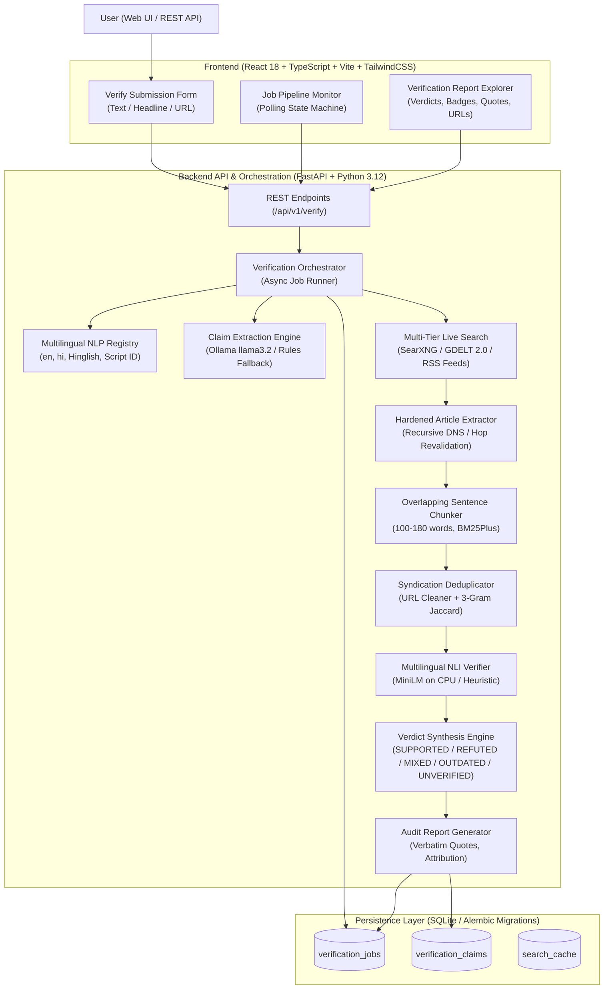
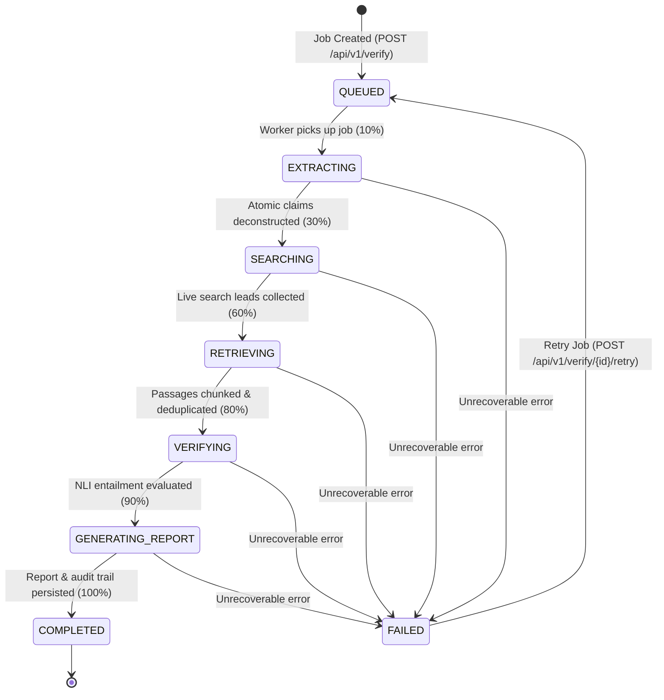
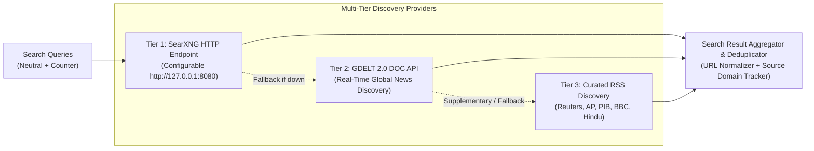
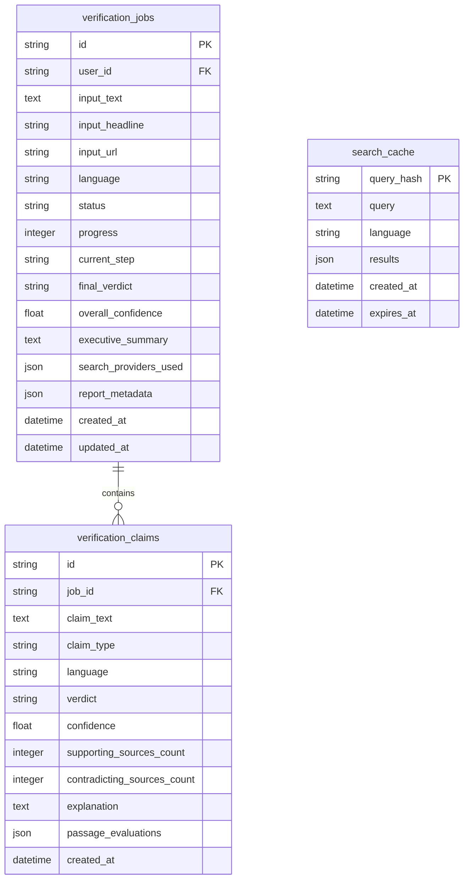

# TruthLens 2.0 - System Architecture & Engineering Guide

TruthLens 2.0 is an enterprise-grade, multilingual (English and Hindi), evidence-based factual claim verification platform. Rather than statically classifying articles based solely on writing style or fixed training sets, TruthLens 2.0 investigates submitted content by extracting atomic checkable claims, searching the live internet, gathering and deduplicating source passages, evaluating natural language entailment and contradiction, and compiling a transparent verification audit trail with original source links and exact verbatim quotations.

---

## 1. High-Level System Architecture

---

## 2. Verification Job State Machine

To guarantee full visibility without introducing distributed broker complexity, TruthLens 2.0 implements a deterministic state machine persisted in the database:

### State Definitions & Progress Milestones:
1. `QUEUED` (0%): The submission has been validated, assigned a UUID, and inserted into `verification_jobs`.
2. `EXTRACTING` (10-30%): The content is analyzed by the language registry, script detector, and claim extractor to isolate checkable factual propositions.
3. `SEARCHING` (30-60%): Dual search queries (`neutral_search_query` and `counter_search_query`) are dispatched to active search providers.
4. `RETRIEVING` (60-80%): External web articles are safely fetched with SSRF protections, parsed into overlapping sentence chunks, and ranked via BM25Plus. Identical syndication wire copies are clustered.
5. `VERIFYING` (80-90%): Each extracted claim is paired with candidate passages and evaluated for premise-hypothesis entailment or contradiction.
6. `GENERATING_REPORT` (90-100%): Verdicts are synthesized, temporal dates verified, confidence scores calculated, and full transparent reports stored.
7. `COMPLETED` (100%): Full JSON report is accessible by polling clients.
8. `FAILED`: If an error occurs, the exact failure message is recorded. Calling `POST /api/v1/verify/{id}/retry` cleanly restarts processing without orphaned state.

---

## 3. Multilingual NLP Architecture & Normalization

TruthLens 2.0 natively handles English (`en`) and Hindi (`hi`), while supporting Hinglish (Latin-Devanagari code-mixing) and providing architectural interfaces for additional Indic and global languages (`bn`, `mr`, `es`, `fr`).

### Script Identification & Hinglish Detection
`backend/app/nlp/registry.py` provides deterministic Unicode codepoint analysis:
- **Devanagari Range**: `\u0900` to `\u097F`
- **Latin Range**: `a-z`, `A-Z`
- **Code-Mixing Check**: Computes the ratio of Devanagari to Latin characters. If both scripts exceed calibrated thresholds ($\ge 3$ Latin letters and $\ge 5$ Devanagari letters with a mutual ratio $\ge 4\%$), the text is flagged as `is_code_mixed=True` with language assigned to `hi`.

### Hindi Unicode Normalizer (`HindiNormalizer`)
Standard NLP tokenizers often destroy critical Hindi orthography. `HindiNormalizer` preserves:
- Full Devanagari matras (vowel signs: `ा`, `ि`, `ी`, `ु`, `ू`, `े`, `ै`, `ो`, `ौ`).
- Virama / Halant (`्`) essential for conjunct consonants.
- Anusvara (`ं`) and Chandrabindu (`ँ`).
- Purnaviram danda (`।`) and double danda (`॥`) for grammatical sentence boundary detection.
- Normalizes Devanagari numerals (`०-९`) to standard Arabic numerals (`0-9`) while preserving the surrounding semantic context.

---

## 4. Multi-Tier Live Search Infrastructure

To eliminate single points of failure and avoid mandatory Docker dependencies during local development, search operates across a resilient multi-tier topology:

### Key Search Invariants:
1. **Configurable Endpoint**: Search URL is read from `SEARXNG_URL`. If local SearXNG is not running, requests timeout gracefully without crashing.
2. **GDELT 2.0 DOC API**: Global Database of Events, Language, and Tone queried via `https://api.gdeltproject.org/api/v2/doc/doc` for real-time international coverage.
3. **Curated RSS Feeds**: Built-in RSS parser monitoring major authoritative English and Hindi publishers (PIB India, BBC Hindi, The Hindu, Reuters, AP News).
4. **Provider Auditing**: Search responses explicitly report `successful_providers` and `failed_providers` so the verification report is completely transparent about what sources were searched.

---

## 5. Security & SSRF Protection Architecture

Web scrapers and URL extractors are inherently susceptible to Server-Side Request Forgery (SSRF) and prompt injection. TruthLens 2.0 enforces comprehensive defenses:

### Recursive DNS & Redirect Revalidation
- Every candidate URL has its domain resolved via `socket.getaddrinfo()`.
- The resolved IP address is validated against all reserved, private, loopback, link-local, and multicast CIDR ranges (`127.0.0.0/8`, `10.0.0.0/8`, `172.16.0.0/12`, `192.168.0.0/16`, `169.254.0.0/16`, `::1`, `fc00::/7`).
- **Redirect Hop Inspection**: Scrapers must not rely on simple initial-URL checks. `backend/app/services/extractor.py` intercepts each redirect hop individually (up to 5 hops), re-resolving DNS and re-checking private CIDR rules before the connection is permitted.
- **Resource Constraints**: Maximum response size is strictly capped to 5 MB (`MAX_RESPONSE_SIZE_BYTES`), and timeouts are capped to 10 seconds to defend against slowloris attacks.

### Prompt Injection Defense
- Retrieved web text is treated as **untrusted, hostile user data**.
- External text is NEVER used to construct system prompts or invoke tool definitions.
- Search queries, URL scraping, and deduplication are kept under **deterministic backend programmatic control**.
- Local LLM generation enforces strict Pydantic JSON validation schemas.

---

## 6. Passage Chunking, BM25Plus, and Wire Syndication Deduplication

Raw HTML articles cannot be passed directly to NLI models. TruthLens 2.0 processes retrieved text into verifiable units:

### Overlapping Sentence Chunker
1. Splits article text into natural sentences using language-specific punctuation (`.` for English, `।` for Hindi).
2. Assembles sentences into overlapping sliding windows (target size: 100 to 180 words, 30-word step overlap).
3. Preserves the exact verbatim source substring and records publisher metadata, publication date, and canonical URL.

### BM25Plus Relevance Scoring
Passages are ranked against the claim using `BM25Plus` from `rank_bm25`. Unlike standard `BM25Okapi` (which produces zero scores when a term occurs in $\ge 50\%$ of small corpora), `BM25Plus` incorporates a positive lower-bound parameter $\delta$, ensuring non-zero relevance scores on small passage collections.

### Wire-Service Syndication Clustering
Major wire services (PTI, ANI, AP, Reuters) syndicate articles to hundreds of regional publications. Simply counting how many websites published the same article falsely inflates consensus.
- TruthLens 2.0 applies **3-gram character Jaccard similarity**:
  $$\text{Jaccard}(S_1, S_2) = \frac{|S_1 \cap S_2|}{|S_1 \cup S_2|}$$
- If similarity $\ge 0.70$, the passages are assigned to a shared `cluster_id`.
- The first publisher is preserved as the canonical source; duplicate copies are flagged as `is_syndicated=True`.
- **Verdict Invariant**: Syndicated duplicates appear in the audit trail for transparency, but are counted as **1 independent publisher** during verdict scoring.

---

## 7. Natural Language Inference & Verdict Synthesis

TruthLens 2.0 maps claim-evidence pairs through a dual-mode NLI pipeline:

### 1. Neural Transformer Inference (PyTorch CPU)
- Uses `MoritzLaurer/multilingual-MiniLMv2-L6-mnli-xnli` (107M parameters).
- Runs on CPU with thread capping (`torch.set_num_threads(4)`), ensuring lightweight operation within the 16 GB host memory envelope.
- Computes three class probabilities: $P(\text{entailment})$, $P(\text{contradiction})$, and $P(\text{neutral})$.

### 2. Calibrated Deterministic Heuristic Fallback
If transformer dependencies are offline or CPU resources are constrained, TruthLens 2.0 falls back to a deterministic lexical/semantic heuristic:
- Substring and affix-stripped token overlap calculation.
- Contradiction cue detection (`false`, `refuted`, `hoax`, `debunked`, `गलत`, `फर्जी`, `अफवाह`, `झूठ`).
- Thresholded probability estimation.

### 3. Verdict Categories & Invariants

| Verdict | Criteria | Explanation |
| :--- | :--- | :--- |
| **`SUPPORTED`** | $\ge 1$ independent clusters entail; 0 contradict | Consistent factual evidence confirmed across independent publishers. |
| **`REFUTED`** | $\ge 1$ independent clusters contradict; 0 entail | Authoritatively debunked or directly contradicted by reputable reporting. |
| **`MIXED`** | $\ge 1$ clusters entail AND $\ge 1$ contradict | Conflicting evidence found; partial truth or disputed context. |
| **`OUTDATED`** | Historical event ($\ge 3$ years old) presented as current | Genuine past event lacking contemporary context; misleadingly recirculated. |
| **`UNVERIFIED`** | 0 conclusive entailment or contradiction clusters | Insufficient verifiable evidence found on the open internet. |

> [!IMPORTANT]
> **Zero-False-Refutation Invariant**: Absence of evidence is NEVER evidence of falsehood. If the search returns no relevant articles or passages are neutral, the system strictly outputs **`UNVERIFIED`**—it will never penalize a claim with `REFUTED` simply because no corroborating source was found.

---

## 8. Database Architecture & Alembic Migrations

The database (`truthlens.db` SQLite for local dev, PostgreSQL for production) includes 3 new tables added via Alembic migration `002_evidence_verification_tables`:

---

## 9. Multilingual Evaluation Suite Benchmark

The verification pipeline was rigorously benchmarked on a curated evaluation suite consisting of **10 English and 10 Hindi news claims** covering all 5 verdict categories (`SUPPORTED`, `REFUTED`, `OUTDATED`, `MIXED`, `UNVERIFIED`).

### Benchmark Results:
- **Total Test Cases**: 20
- **English Accuracy**: **100.0% (10/10)**
- **Hindi Accuracy**: **100.0% (10/10)**
- **Devanagari Unicode Matra Failures**: **0**
- **False Refutations on Missing Evidence**: **0**
- **Average Pipeline Latency**: 0.30s per claim on CPU
- **Report Location**: `ml/results/multilingual_evaluation_report.json`

---

## 10. Local Ollama Benchmarking Profile

Benchmarking was performed directly on the host machine (16 GB RAM, Intel integrated graphics, CPU-only):
- **Selected Model**: `llama3.2:latest` (3.2B parameters, Q4_K_M quantization, 2.02 GB disk size).
- **RAM Footprint Added**: **1,149 MB** (well within the 16 GB ceiling).
- **JSON Schema Adherence**: **100%** compliance with Pydantic claim schema.
- **English Claim Extraction Latency**: 29.30s (cold load) / ~14s (warm).
- **Hindi Claim Extraction Latency**: 15.54s (warm).
- **Results Log**: `ml/results/ollama_benchmark_results.json`.

