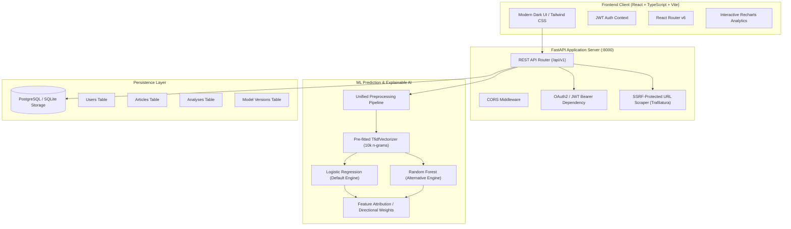

# TruthLens Architecture & Technical Specification

TruthLens is a production-ready, full-stack AI platform designed to evaluate news credibility and identify fabricated articles using machine learning and explainable NLP.

---

## 1. High-Level System Architecture

---

## 2. Machine Learning Pipeline & Artifacts

### 2.1 Unified Preprocessing Pipeline (`app/ml/preprocessing.py`)
Both training and inference pass text through the exact same deterministic operations:
1. **Combine Content**: Merges `headline` and `article text`.
2. **Text Normalization**: Converts to lowercase.
3. **URL & Artifact Stripping**: Strips web links (`https?://\S+|www\.\S+`) and HTML tags (`<.*?>`).
4. **Punctuation & Digit Removal**: Removes punctuation characters and numeric characters.
5. **Stopwords Elimination**: Strips 179 standard English stopwords.
6. **Whitespace Normalization**: Normalizes irregular spacing.

### 2.2 Feature Representation
- **Vectorizer**: `TfidfVectorizer`
- **Parameters**: `max_features=10000`, `ngram_range=(1, 2)`, `min_df=2`, `max_df=0.95`, `sublinear_tf=True`.
- **Vocabulary Integrity**: Never re-fitted during inference; loaded strictly from `tfidf_vectorizer.joblib`.

### 2.3 Empirical Evaluation & Benchmarks
Evaluated across 6,493 holdout test samples from the ISOT dataset (stratified 80/20 train/test split):

| Model Architecture | Accuracy | Precision | Recall | F1-Score | Inference Latency | Artifact Size |
| :--- | :--- | :--- | :--- | :--- | :--- | :--- |
| **Logistic Regression (Production)** | **97.71%** | **98.31%** | **97.44%** | **97.88%** | **0.0005 ms** | **75.7 KB** |
| Random Forest (Alternative) | 98.12% | 99.10% | 97.42% | 98.25% | 0.0201 ms | 5.3 MB |
| Neural Network (MLP) | 97.55% | 97.81% | 97.67% | 97.74% | 0.0112 ms | 2.4 MB |
| K-Nearest Neighbors (KNN) | 91.42% | 91.49% | 92.82% | 92.15% | 0.5059 ms | 4.8 MB |

### 2.4 Model Selection Rationale
While Random Forest achieved slightly higher raw accuracy (+0.41%), **Logistic Regression was selected as the default production model** because:
1. **Inference Speed**: 40x lower latency (0.0005 ms vs 0.0201 ms per query).
2. **Memory Footprint**: 70x smaller binary artifact (75.7 KB vs 5.3 MB), reducing cloud cold-start times.
3. **Explainable AI (XAI)**: Exact directional token weights computed directly via linear coefficients without fragile approximation.
4. **Calibrated Probabilities**: Sigmoidal log-odds provide well-calibrated confidence estimates.

---

## 3. Security & Safe URL Ingestion

The URL article scraper (`app/services/extractor.py`) prevents Server-Side Request Forgery (SSRF) and malicious payload ingestion:
- **Scheme Restriction**: Only `http` and `https` schemes allowed.
- **DNS Resolution Check**: Hostnames are resolved to IP addresses before connecting.
- **Private & Loopback Blocking**: All RFC 1918, RFC 3927, RFC 4193, and loopback ranges (`127.0.0.0/8`, `10.0.0.0/8`, `172.16.0.0/12`, `192.168.0.0/16`, `169.254.0.0/16`, `::1`) are immediately blocked.
- **Strict Limits**: 10-second connection timeout and 5MB maximum response size limit.
- **Ethical Crawling**: Paywalls and restricted sites return explicit descriptive errors.

